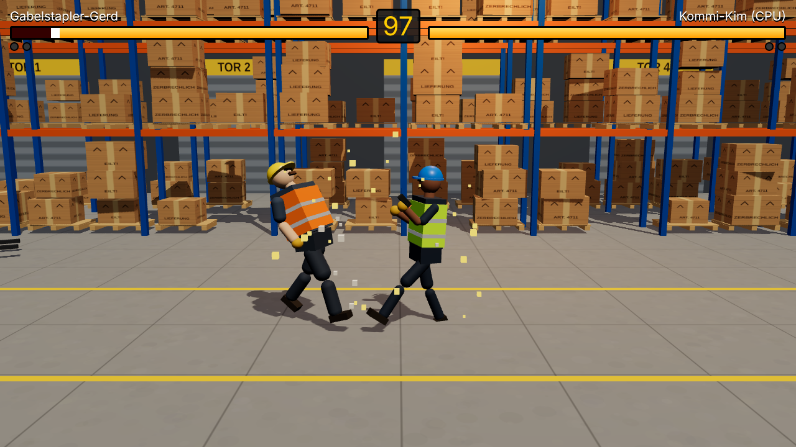

# 📦 Warehouse Fighter

Ein 3D-Kampfspiel im Stil von Street Fighter / Tekken – ausgetragen in Lager 3,
zwischen Hochregalen, Europaletten und einem geparkten Gabelstapler.
Gerendert mit **three.js**, gehostet auf **Cloudflare** (Worker + Durable Objects für Online-Kämpfe).



> Erster Entwurf. Alles (Modelle, Halle, Sounds) ist prozedural erzeugt – keine externen Assets.

## Spielmodi

| Modus | Beschreibung |
| --- | --- |
| Gegen CPU | Einzelspieler gegen einen einfachen KI-Gegner |
| 2 Spieler lokal | Zwei Spieler an einer Tastatur (oder zwei Gamepads) |
| Online | Raum erstellen, Code/Link teilen, 1-gegen-1 über das Internet |

## Kämpfer

| | Gabelstapler-Gerd | Kommi-Kim | Packer Piet |
| --- | --- | --- | --- |
| Typ | schwer & langsam | schnell & fragil | ausgewogen |
| Leicht | Klemmbrett-Klatscher | Scanner-Jab | Klebeband-Ohrfeige |
| Schwer | Gabelzinken-Stoß | Picklisten-Kick | Karton-Kopfnuss |
| Tief (↓ + schwer) | Palettenrutscher | Rollwagen-Tritt | Stretchfolien-Feger |
| Sprung | Hubmast-Hammer | Regalsprung-Kick | Paket-Bombe |
| Spezial (Projektil) | Europaletten-Wurf | Barcode-Strahl | Karton-Kanone |

## Steuerung

| Aktion | Spieler 1 | Spieler 2 | Gamepad |
| --- | --- | --- | --- |
| Bewegen / Springen / Ducken | `W A S D` | Pfeiltasten | Stick / D-Pad |
| Leichter Angriff | `F` | `,` | X / □ |
| Schwerer Angriff | `G` | `.` | Y / △ oder A / ✕ |
| Spezial | `H` | `-` | B / ○ |

- **Blocken:** vom Gegner weg halten. Tiefschläge müssen **geduckt**, Sprungangriffe **stehend** geblockt werden.
- Gegen CPU und online funktionieren beide Tastaturbelegungen.
- Best of 3 Runden, 99 Sekunden pro Runde. KO heißt hier **„Feierabend!“**.

## Lokal entwickeln

Voraussetzung: Node.js 20+.

```bash
npm install
npm run build          # einmal bauen, damit ./dist existiert
npm run dev:worker     # Worker + Durable Object lokal (wrangler dev, Port 8787)
npm run dev            # in zweitem Terminal: Vite mit Hot Reload, http://localhost:5173
```

Vite leitet `/api` (inkl. WebSockets) an den lokalen Worker weiter, d. h. Online-Matches
lassen sich lokal mit zwei Browserfenstern testen.

Alternativ alles in einem Prozess wie in Produktion: `npm run preview` → http://localhost:8787

Weitere Befehle: `npm run typecheck`, `npm test` (Unit-Tests der Spiellogik).

## Deployment auf Cloudflare

Das Projekt ist **ein einziger Cloudflare Worker**: Er liefert das gebaute Frontend aus
(Workers Static Assets) und beherbergt das Durable Object `MatchRoom` für Online-Kämpfe.
Durable Objects auf SQLite-Basis laufen auch im kostenlosen Workers-Plan.

### Einmalig von der Kommandozeile

```bash
npx wrangler login
npm run deploy         # = vite build && wrangler deploy
```

Danach läuft das Spiel unter `https://warehouse-fighter.<dein-subdomain>.workers.dev`.
Eine eigene Domain lässt sich im Cloudflare-Dashboard unter *Workers & Pages → warehouse-fighter → Settings → Domains & Routes* hinzufügen.

### Automatisch per GitHub Actions

`.github/workflows/ci.yml` prüft jeden PR (Typecheck, Tests, Build) und deployt bei Push auf `main`,
sobald im Repo unter *Settings → Secrets and variables → Actions* diese Secrets gesetzt sind:

- `CLOUDFLARE_API_TOKEN` – API-Token mit der Vorlage „Edit Cloudflare Workers“
- `CLOUDFLARE_ACCOUNT_ID` – steht im Cloudflare-Dashboard rechts in der Übersicht

Ohne Secrets wird der Deploy-Schritt einfach übersprungen.

Alternativ: im Cloudflare-Dashboard *Workers & Pages → Create → Import a repository* wählen,
dieses Repo verbinden, Build-Befehl `npm run build`, Deploy-Befehl `npx wrangler deploy`.

## Architektur

```
src/
  shared/      Spiellogik – läuft im Browser UND im Durable Object
    game.ts        Simulation mit 60 Ticks/s (Bewegung, Hitboxen, Block, Runden)
    characters.ts  Kämpferwerte und Angriffe
    protocol.ts    WebSocket-Nachrichten
  client/      Browser
    main.ts        Menüs, Spielmodi, Hauptschleife
    renderer.ts    three.js-Szene, Kamera, Partikel, Projektile
    stage.ts       Lagerhalle (Hochregale, Paletten, Stapler, Rolltore)
    fighterModel.ts Lagerarbeiter-Modelle + prozedurale Animation
    input.ts / ai.ts / audio.ts / net.ts
  worker/
    index.ts       Worker-Routing + Durable Object MatchRoom
```

**Online-Netcode:** serverautoritativ. Jeder Raum ist ein Durable Object (`idFromName(code)`),
das beide WebSockets hält, die Eingaben der Spieler sammelt, die gemeinsame Simulation mit 60 Hz
rechnet und den Zustand mit 30 Hz an beide Browser schickt. Der Client sendet nur seine Tasten
und rendert den empfangenen Zustand (mit Glättung). Dadurch gibt es keine Desyncs und kein Schummeln,
dafür spürt man die Latenz zum nächsten Cloudflare-Standort (in Europa typischerweise 10–40 ms).

## Ideen für die nächsten Schritte

- Rollback-Netcode bzw. Client-Prediction für weniger spürbare Latenz
- Super-Angriff mit „Schicht-Meter“ (z. B. Gerd fährt mit dem Stapler durchs Bild)
- Würfe/Griffe, Combos mit Cancel-Fenstern, Knockdown + Aufstehen
- Mehr Kämpfer (Lagerleiterin, LKW-Fahrer, Inventur-Praktikant) und Arenen (Kühlhaus, Laderampe)
- Richtige 3D-Modelle (glTF) mit Animationen statt Grundkörpern
- Matchmaking-Queue statt nur Raumcodes, Ranglisten via D1
- Touch-Steuerung für Smartphones
