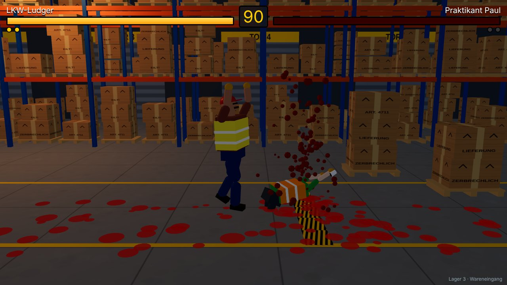
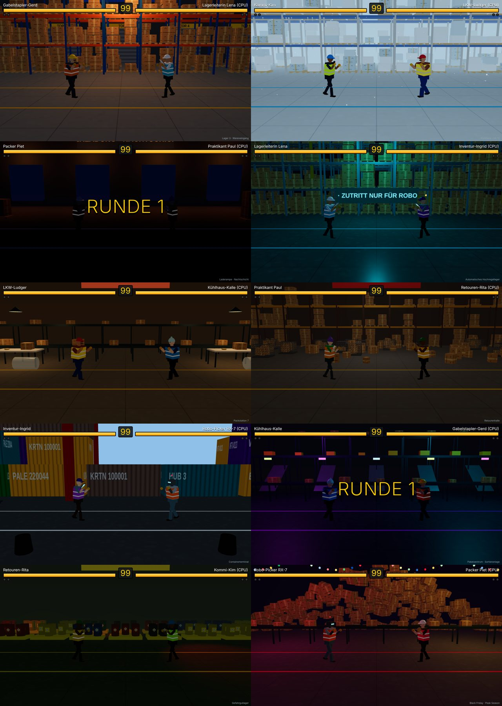

# 📦 Warehouse Fighter

Ein 3D-Kampfspiel im Stil von Street Fighter / Tekken – ausgetragen in Lager 3,
zwischen Hochregalen, Europaletten und einem geparkten Gabelstapler.
Gerendert mit **three.js**, gehostet auf **Cloudflare** (Worker + Durable Objects für Online-Kämpfe).



> Erster Entwurf. Alles (Modelle, Halle, Sounds) ist prozedural erzeugt – keine externen Assets.

## Spielmodi

| Modus | Beschreibung |
| --- | --- |
| Arcade | Kämpfe dich nacheinander durch alle 9 Gegner, jeder in einer anderen Halle. Die CPU wird mit jedem Gegner stärker |
| Gegen CPU (frei) | Kämpfer, CPU-Gegner und Arena frei wählen |
| 2 Spieler lokal | Zwei Spieler an einer Tastatur (oder zwei Gamepads) |
| Online | Raum erstellen, Arena wählen, Code/Link teilen, 1-gegen-1 über das Internet |

## Kämpfer (10)

| Kämpfer | Typ | Spezial (Projektil) |
| --- | --- | --- |
| 🏗️ Gabelstapler-Gerd | schwer, langsam | Europaletten-Wurf |
| 📟 Kommi-Kim | schnell, fragil | Barcode-Strahl |
| 📦 Packer Piet | ausgewogen | Karton-Kanone |
| 📋 Lagerleiterin Lena | ausgewogen, gute Reichweite | KPI-Klemmbrett |
| 🚚 LKW-Ludger | sehr schwer, sehr langsam | Hupkonzert (Schallwelle) |
| ☕ Praktikant Paul | sehr schnell, wenig Ausdauer | Kaffeebecher-Wurf |
| 🏷️ Inventur-Ingrid | schnell, schnelles Projektil | Etiketten-Salve |
| 🧊 Kühlhaus-Kalle | schwer, rutschige Grätsche | Eisblock |
| ↩️ Retouren-Rita | ausgewogen | Rücksende-Paket |
| 🤖 Robo-Picker RX-7 | Roboter, verliert Öl statt Blut | Lidar-Strahl |

Jeder hat einen leichten, schweren, tiefen (↓ + schwer) und Sprungangriff – Namen und Werte in `src/shared/characters.ts`.

## Arenen (10)

Lager 3 · Wareneingang · Kühlhaus −24 °C (Schneefall) · Laderampe bei Nacht · Automatisches Hochregallager (fahrende Shuttles) ·
Packstation 7 (laufende Förderbänder) · Retourenhalle · Containerterminal (draußen am Kai) · Paketzentrum-Sortieranlage ·
Gefahrgutlager (rotierende Warnleuchten) · Black Friday Peak Season (Paketberg, Lichterketten)



## Finisher, Blut und Pause

- Treffer spritzen Blut (beim Roboter Öl), die Flecken bleiben eine Weile auf dem Hallenboden.
- Der **finale Schlag** löst eine **Zeitlupe** aus, die Kamera zoomt heran, und je nach Runde fliegt dem Verlierer
  **der Kopf** oder **ein Arm** weg – oder er kracht **quer durch die Halle ins Regal**. Die Zeitlupe läuft in der
  gemeinsamen Simulation, online sehen also beide Spieler denselben Finisher.
- **Pause:** `Esc`, `P` oder Start am Gamepad. Blut lässt sich in den Optionen abschalten (wird im Browser gespeichert).
  Online läuft der Kampf während der Pause weiter.

## Kampfsystem (Tekken-Stil)

Jeder Kämpfer hat **18 Moves** mit eigenen Namen. Die **Kampfschule** (Hauptmenü und Pausenmenü) erklärt Grundlagen,
Kombos mit Schwierigkeitsgrad, die komplette Befehlsliste jedes Kämpfers und die Steuerung.

- **Kombos:** Angriffe lassen sich bei Treffer in den nächsten Angriff abbrechen, z. B. *Leicht, Leicht, Schwer*,
  *Leicht, Tritt, Tritt*, *Schwer, Tritt* oder *↓ Leicht, ↓ Leicht, ↓ Tritt*. Ein Eingabepuffer verzeiht knappes Timing,
  mit jedem Treffer in der Kombo sinkt der Schaden etwas.
- **Launcher (← + Schwer)** schleudert den Gegner hoch, danach sind **Juggles** in der Luft möglich.
- **Würfe (Leicht + Tritt nah am Gegner)** gehen durch den Block, **Feger (↓ + Schwer)** und **Überkopf (→ + Schwer)**
  werfen zu Boden. Am Boden liegt man kurz unverwundbar und steht dann auf.
- **Dash:** zweimal vor tippen, **Rückwärts-Dash:** zweimal zurück.
- Die CPU nutzt Kombos, Launcher, Würfe und Dashs, blockt tief und hoch.

## Grafik und Sound

- **Animationen** über federnde Gelenke: Ausholen, Durchziehen, Gewichtsverlagerung, Treffer- und Sturzreaktionen.
- **Live-Schatten:** Die Sonne folgt dem Kampf mit einem engen, scharfen Schattenbereich, dazu schwenkt ein Hallenstrahler
  über die Kampffläche.
- **Retro-Pixelfilter** (aus / leicht / mittel / stark, in den Optionen): niedrigere Auflösung, reduzierte
  Farben, Dithering und Scanlines.
- **Sound** komplett synthetisiert: geschichtete Treffer je nach Gewicht, Hallenhall, Klonk beim Blocken, Aufprall beim
  Knockdown, eigener Klang je Geschoss, Ansager per Sprachausgabe („Runde eins“, „Schichtbeginn!“, „Feierabend!“).
- **90er-Arcade-Musik:** ein Menütitel und fünf Kampftitel („Schichtbeginn“, „Gabelstapler-Turbo“, „Kühlhaus-Techno“,
  „Nachtschicht“, „Endgegner“). Automatisch passend zur Arena, im Arcade-Finale läuft der Endgegner-Titel – oder fest
  gewählt in den Optionen.

## Menüs

- **Hauptmenü:** Spielen (Arcade, gegen CPU, 2 Spieler lokal) · Online (Raum erstellen/beitreten) · Kampfschule · Optionen
- **Pausenmenü:** Weiter · Kampf neu starten · Befehlsliste & Kombos · Optionen · Hauptmenü
- **Optionen:** Retro-Filter, Blut, Musik an/aus, Musiktitel (mit Vorschau), Musik- und Effekt-Lautstärke, Ansager.
  Alles wird im Browser gespeichert. `Esc` geht in jedem Untermenü zurück.

## Steuerung

| Aktion | Spieler 1 | Spieler 2 | Gamepad |
| --- | --- | --- | --- |
| Bewegen / Springen / Ducken | `W A S D` | Pfeiltasten | Stick / D-Pad |
| Leichter Angriff | `F` | `,` | X / □ |
| Schwerer Angriff | `G` | `.` | Y / △ |
| Tritt | `V` | `M` | A / ✕ |
| Spezial | `H` | `-` | B / ○ |
| Wurf | `F` + `V` | `,` + `M` | RB / R1 |

- **Blocken:** vom Gegner weg halten. Tiefschläge müssen **geduckt**, Sprungangriffe **stehend** geblockt werden.
- Gegen CPU und online funktionieren beide Tastaturbelegungen.
- Best of 3 Runden, 99 Sekunden pro Runde. KO heißt hier **„Feierabend!“**.

## Lokal entwickeln

Voraussetzung: Node.js 20+.

```bash
npm install
npm run build          # einmal bauen, damit ./dist existiert
npm run dev:worker     # Worker + Durable Object lokal (wrangler dev, Port 8787)
npm run dev            # in zweitem Terminal: Vite mit Hot Reload, http://localhost:5173
```

Vite leitet `/api` (inkl. WebSockets) an den lokalen Worker weiter, d. h. Online-Matches
lassen sich lokal mit zwei Browserfenstern testen.

Alternativ alles in einem Prozess wie in Produktion: `npm run preview` → http://localhost:8787
(`wrangler.jsonc` enthält einen Build-Schritt, Wrangler baut das Frontend also selbst).

Weitere Befehle: `npm run typecheck`, `npm test` (Unit-Tests der Spiellogik).

## Deployment auf Cloudflare

Das Projekt ist **ein einziger Cloudflare Worker**: Er liefert das gebaute Frontend aus
(Workers Static Assets) und beherbergt das Durable Object `MatchRoom` für Online-Kämpfe.
Durable Objects auf SQLite-Basis laufen auch im kostenlosen Workers-Plan.

### Einmalig von der Kommandozeile

```bash
npx wrangler login
npm run deploy         # = wrangler deploy (baut vorher automatisch das Frontend)
```

Danach läuft das Spiel unter `https://warehouse-fighter.<dein-subdomain>.workers.dev`.
Eine eigene Domain lässt sich im Cloudflare-Dashboard unter *Workers & Pages → warehouse-fighter → Settings → Domains & Routes* hinzufügen.

### Automatisch per GitHub Actions

`.github/workflows/ci.yml` prüft jeden PR (Typecheck, Tests, Build) und deployt bei Push auf `main`,
sobald im Repo unter *Settings → Secrets and variables → Actions* diese Secrets gesetzt sind:

- `CLOUDFLARE_API_TOKEN` – API-Token mit der Vorlage „Edit Cloudflare Workers“
- `CLOUDFLARE_ACCOUNT_ID` – steht im Cloudflare-Dashboard rechts in der Übersicht

Ohne Secrets wird der Deploy-Schritt einfach übersprungen.

Alternativ: im Cloudflare-Dashboard *Workers & Pages → Create → Import a repository* wählen
(Workers Builds) und dieses Repo verbinden. Die Standardbefehle (`npx wrangler deploy` bzw. für
PR-Branches `npx wrangler versions upload`) reichen, weil `wrangler.jsonc` das Frontend vorher selbst baut.
Hinweis: Preview-Builds für PRs klappen erst, wenn `main` einmal erfolgreich deployt wurde
(das Durable Object braucht beim ersten Mal ein echtes `wrangler deploy`).

## Architektur

```
src/
  shared/      Spiellogik – läuft im Browser UND im Durable Object
    game.ts        Simulation mit 60 Ticks/s (Bewegung, Hitboxen, Block, Runden)
    characters.ts  Kämpferwerte und Angriffe
    stages.ts      Liste der Arenen
    protocol.ts    WebSocket-Nachrichten
  client/      Browser
    main.ts        Menüs, Spielmodi, Hauptschleife
    renderer.ts    three.js-Szene, Kamera, Partikel, Projektile
    stage.ts       die 10 Arenen (Baukasten aus Regalen, Paletten, Förderbändern …)
    fighterModel.ts Lagerarbeiter-Modelle + prozedurale Animation
    input.ts / ai.ts / audio.ts / net.ts
  worker/
    index.ts       Worker-Routing + Durable Object MatchRoom
```

**Online-Netcode:** serverautoritativ. Jeder Raum ist ein Durable Object (`idFromName(code)`),
das beide WebSockets hält, die Eingaben der Spieler sammelt, die gemeinsame Simulation mit 60 Hz
rechnet und den Zustand mit 30 Hz an beide Browser schickt. Der Client sendet nur seine Tasten
und rendert den empfangenen Zustand (mit Glättung). Dadurch gibt es keine Desyncs und kein Schummeln,
dafür spürt man die Latenz zum nächsten Cloudflare-Standort (in Europa typischerweise 10–40 ms).

## Ideen für die nächsten Schritte

- Rollback-Netcode bzw. Client-Prediction für weniger spürbare Latenz
- Super-Angriff mit „Schicht-Meter“ (z. B. Gerd fährt mit dem Stapler durchs Bild)
- Wand-Kombos, Konter und Seitwärtsschritt (Tekken-Sidestep)
- Richtige 3D-Modelle (glTF) mit Animationen statt Grundkörpern
- Matchmaking-Queue statt nur Raumcodes, Ranglisten via D1
- Touch-Steuerung für Smartphones
